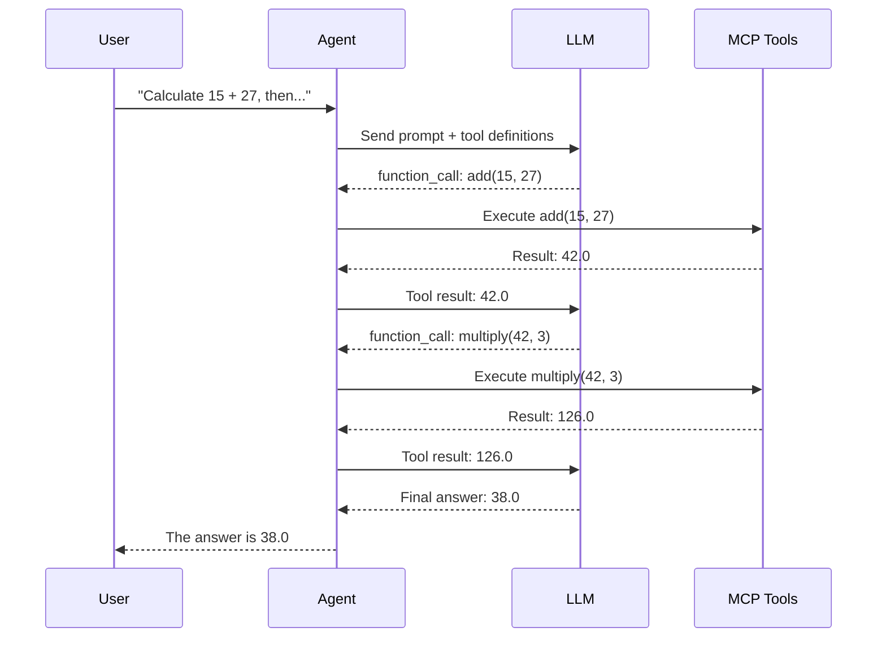

# MyFastMCP

A FastMCP server providing math tools (add, subtract, multiply, divide).

## Setup

1. Install dependencies:
   ```bash
   uv sync
   ```

2. Create a `.env` file with your API keys:
   ```
   GOOGLE_API_KEY=your_gemini_api_key
   OPENAI_API_KEY=your_openai_api_key
   ```

## Running the Server

```bash
# Run as stdio server (default)
python main.py

# Run as HTTP server
python main.py --http --port 8000
```

## Testing the API with Bruno

This project includes a [Bruno](https://www.usebruno.com/) collection for testing the MCP server via HTTP.

## LLM Tool Calling Simulations

This project includes two simulations of LLM tool calling:

### 1. test_with_llm.py - Direct LLM Integration

Uses [litellm](https://docs.litellm.ai/) to interface with various LLM providers with a unified API.

```bash
# Run with Gemini (default)
python test_with_llm.py

# Run with OpenAI
python test_with_llm.py --model openai
```

### 2. test_with_adk.py - Google ADK Integration

Uses Google's [Agent Development Kit (ADK)](https://google.github.io/adk-docs/) to connect to the MCP server. ADK handles the tool calling loop automatically.

```bash
# Run with Gemini (default)
python test_with_adk.py

# Run with OpenAI
python test_with_adk.py --model openai
```

### How It Works

1. The script starts the MCP server as a subprocess (or connects to a running server)
2. It connects to the server via stdio
3. Lists available tools (add, subtract, multiply, divide)
4. Sends a math problem to the LLM with tool definitions
5. The LLM decides to call a tool, the script executes it via MCP
6. Returns the result to the LLM for final answer

#### ADK Approach (test_with_adk.py)



ADK handles the tool calling loop automatically.

#### Direct LLM Approach (test_with_llm.py)


The script manually handles tool calling loop.

## LLM Context Inspection

When running either test script, it captures each LLM request context window and writes it to a markdown file:

- `llm_context_windows_adk.md` - generated by `test_with_adk.py`
- `llm_context_windows_llm.md` - generated by `test_with_llm.py`

Each file shows:

- System instructions
- Full conversation history (cumulative across turns)
- Tool definitions with descriptions and JSON schemas
- Function calls and responses

This is useful for understanding what the LLM sees at each step of the tool calling loop.
